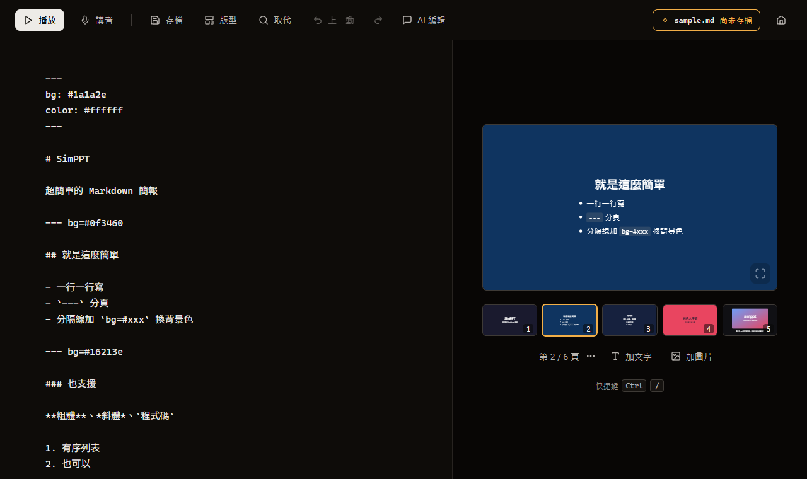

<p align="center">
  
</p>

<h1 align="center">SimPPT</h1>

<p align="center">
  超簡單的 Markdown 簡報播放器 — <b>一個零依賴的 <code>index.html</code>，雙擊就能用</b>。
</p>



寫給「簡單文字、背景色、一點點圖」的簡報：不用裝任何東西、不用 build、不用連網。

- **左邊寫、右邊看** — markdown 打下去，游標在哪一頁，右邊就預覽哪一頁
- **右邊也能直接動** — 拖曳、縮放、雙擊改字、加文字、加圖片，動完自動寫回 markdown
- **圖片和影片** — 貼上截圖自動上傳；YouTube 網址或影片檔一行就能放進投影片
- **上台用的東西都有** — 全螢幕播放、講者台雙視窗、演講稿、倒數頁、畫筆

## 開始用

**開本機 server（推薦）**

```sh
node server.js        # → http://localhost:4646（PORT 環境變數可換）
```

首頁會列出 `decks/` 裡的簡報，點一下進編輯器。也可以用網址直接指定：`http://localhost:4646/?deck=decks/templates.md`。

**或零安裝**

1. 雙擊 `index.html` 打開瀏覽器
2. 按「**新簡報**」直接開始寫，或按「看範例」、拖入你的 `.simppt`／`.md`
3. 含圖片的簡報：把簡報檔和圖片放同一個資料夾，**整個資料夾拖進來**
4. `F` 全螢幕開始播（或錄影）

## 簡報語法

```md
---
bg: #1a1a2e        ← 檔首 frontmatter：全域背景色 / 文字色
color: #ffffff
---

# 第一頁標題
簡單文字內容

--- bg=#0f3460     ← 分隔線同行 key=value，覆蓋這一頁的設定

## 第二頁
- 支援列表
- **粗體**、*斜體*、`程式碼`

---

   ← 圖片自動置中縮放
```

**基本**

- `---` 獨立一行＝分頁（恰好三個 dash）
- 支援：`#`/`##`/`###` 標題、無序/有序列表、圖片、粗斜體、行內 code、連結、段落
- 檔案一開頭（frontmatter 之後、任何內容之前）的分隔線是「第一頁的設定」，不會多出一張空白頁

**影片**

- 寫法跟圖片一樣：``（YouTube）或 ``（`.mp4`／`.webm`／`.mov` 影片檔）
- 在編輯區的空行直接貼上影片網址，會自動變成這一行
- 編輯時是一塊可以拖、可以縮放的東西（YouTube 顯示封面），**播放時才是真的播放器**

**顏色與寬度**

- `--- bg=#0f3460 color=#eee`：只改這一頁
- `--- set bg=#ffffff color=#1c1c1e`：**從這頁起**都用這組設定（例如前幾張黑底白字、後面全部白底黑字，切一次就好）
- `accent: #d84a3f`（frontmatter 或分隔線 `accent=`）：**粗體**自動帶這個顏色，標重點用
- `width: 95`（frontmatter 全域）或 `--- width=95`（單頁）：內容行寬，佔螢幕寬的百分比（預設 84），字太快換行就調大

**版型**（預設是置中）

| 寫法 | 樣子 |
|---|---|
| `--- layout=top` | **標題在上** — 標題在上、內文在下、左對齊 |
| `--- layout=bullets` | **列點** — 標題加清單，`-` 是短橫線標記、`1.` 是 01 02 03 編號 |
| `--- layout=cols` | **兩欄** — 每個 `##` 小標各成一欄（最多三欄）；沒有小標的清單自動分兩欄 |
| `--- layout=split` | **左圖右文** — 該頁的圖片固定在左半邊，標題和文字排右邊 |
| `--- layout=big` | **大字** — `#` 放一個數字或一個詞，下面一行說明 |

- 編輯器上方「**版型**」按鈕點一個，就在這頁後面插入一頁帶範例內容的新頁；已經有的頁要換版型，改分隔線上的 `layout=`
- `layout` 只管寫的那一頁，不會跟著 `set` 帶到後面；想整份都用同一種，寫在檔首 frontmatter（`layout: top`）
- 現成範例見 `decks/templates.md`

**個別的字和區塊**

- 行尾 `{s=130 c=#e94560 b=1}`：這一塊的字級（百分比）、顏色、粗體（例：`重點句 {s=130 c=#e94560}`）
- 句中 `{{文字|s=150 c=#e94560 b=1}}`：只有這幾個字變大/變色/加粗（例：`你唯一要 {{ALL IN|s=180 c=#e94560}} 的就是自己`）
- 行尾 `{x= y= w=}`：這一塊的位置和寬度（百分比）— 通常不用手寫，在預覽上拖就會自動寫好

**上台用**

- `note: 想講的話`：演講稿，觀眾看不到，播放時按 `N` 或在講者台看
- `--- countdown=3:00`：**倒數頁** — 播放時顯示大字倒數（`3:00` 或秒數 `180`），開播等待頁用；數到 0 閃爍提示，重進該頁重新起算

## 編輯器

**存檔**

- `Ctrl+S` 存檔：開啟的檔案直接**寫回原檔**。新簡報第一次存檔會問檔名、存進 `decks/`（開本機 server 時；撞名會請你改名，**不會蓋掉既有的檔**）；沒開 server 就跳另存視窗（Chrome/Edge）或下載檔案
- 右上角寫著**存在哪個檔、存了沒**（尚未存檔／有未存的變更／已存檔＋時間／存檔失敗）。「已存檔」是寫完再讀回來比對過才顯示；存檔失敗會另外下載一份當備份
- 重整／關瀏覽器會**自動記住現場**（內容、頁數、開啟的檔案），回來繼續編；「首頁」鈕才會清掉
- 首頁的「歷史備份」：編輯內容每分鐘自動備份，最多 20 份

**在右邊預覽上直接排版**

- **拖曳**＝移動，自動吸附置中線與其他區塊；**右下角把手**＝縮放（圖片改寬度、文字改字級）
- **雙擊文字**＝原地改字：標題按 `Enter` 完成；段落和清單 `Enter` 換行、`Ctrl+Enter` 或點旁邊完成；`Esc` 取消；清單一點一行
- **點一下文字塊**浮出迷你工具列：加粗、字級放大縮小、色票＋自訂色、等距、清除（回到預設排版）；`Shift`+點可多選批次操作
- 預覽下方的「**加文字**」「**加圖片**」：在這一頁最後面放一塊。加文字會直接進入改字狀態；加圖片從電腦選一張，自動上傳後放上去
- **在編輯區貼上圖片**（`Ctrl+V` 截圖）：自動上傳到 urusai.cc 圖床並插入那一行
- 雙擊圖片＝還原該塊的位置和大小

**頁面**

- 在下方縮圖上**按右鍵**（或頁碼旁的「⋯」）：複製這一頁、在後面新增一頁、往前移、往後移、刪除。搬動或刪除後其他頁的配色不會跑掉
- **拖曳縮圖**直接排順序，放開的位置有一條標記線
- **點一下右邊的預覽**，之後 `←` `→`（或 `↑` `↓`、`PageUp`／`PageDown`、`Home`／`End`）就是換頁；點回左邊繼續寫字

**上一動／下一動**

- `Ctrl+Z`／`Ctrl+Y`：打字、拖曳編排、插入版型頁、整頁操作、全部取代、AI 編輯都能一步一步退回去再重做；連續打字算一步

**AI（需要本機 server 和 `claude` CLI）**

- 首頁「**AI 生成**」：貼上內容，生成一份簡報
- 編輯器「**AI 編輯**」：跟 AI 說要怎麼調整這份簡報
- 預覽下方「**AI 插入**」：說一句話（例如「講番茄鐘工作法，3 張以內」），AI 寫幾頁接在目前這頁後面。新頁沿用這份簡報的配色，其他頁不動；不滿意按「復原」

**檔案在別處被改了**

- 編輯器開著時，別的程式（AI 透過下面的 API／MCP、另一個編輯器）改了同一個檔，編輯器會自己載入新版，旁邊有「復原」
- 你手上有還沒存的修改時不會被換掉，只提示「檔案在別處有新版」，按「載入新版」才換

## 簡報檔：`.simppt`

一份簡報就是一個 `.simppt` 檔，內容是上面那套 Markdown，用任何文字編輯器都能開。新簡報存檔預設用這個副檔名；舊的 `.md` 照樣能開、能存回原檔（存檔時名字打 `.md` 也可以繼續用 `.md`）。

## 讓程式和 AI 改簡報

逐頁操作有三個入口，背後是同一份 `lib/deck-api.mjs`。頁碼從 1 開始，空白頁也算一頁。

**MCP（給 Claude Code 之類的 AI 用）**

```sh
claude mcp add simppt -s user -- node /path/to/simppt/mcp/server.mjs
```

直接讀寫 `decks/` 裡的檔案，本機 server 不必開著（`SIMPPT_ROOT` 可以指到別的資料夾）。裝好之後就能說「在我那份演講簡報第 8 頁後面加 3 張講 XXX」。工具：`list_decks`、`get_outline`、`read_slides`、`insert_slides`、`replace_slide`、`delete_slide`、`move_slide`。

**HTTP API（本機 server）**

| 方法 | 路徑 | 內容 |
|---|---|---|
| GET | `/api/decks` | 簡報清單 |
| GET | `/api/outline?deck=名稱` | 每頁的頁碼、標題、版型 |
| GET | `/api/slides?deck=名稱&from=2&to=4` | 那幾頁的原文 |
| POST | `/api/slides/insert` | `{ "deck", "after", "markdown" }`，`after: 0` 放最前面 |
| POST | `/api/slides/replace` | `{ "deck", "page", "markdown" }` |
| POST | `/api/slides/delete` | `{ "deck", "page" }` |
| POST | `/api/slides/move` | `{ "deck", "from", "to" }` |

`deck` 可以是 `decks/` 底下的路徑、檔名、不含副檔名的檔名，或只符合一份簡報的片段。POST 要帶 `Content-Type: application/json`；有設 `SIMPPT_TOKEN` 時要帶 `X-Simppt-Token`。回傳 `{ "ok": true, … }` 或 `{ "ok": false, "code", "message" }`。

讀大綱、讀頁、每次寫入都會回一個 `version`。寫入時把它帶回去（`"version": "…"`），簡報在你讀過之後被別人改過就會被擋下（`ECHANGED`），不會改到錯的頁；不帶就不檢查。

沒有設 token 的 server 只回應本機（`localhost`／`127.0.0.1`），而且不接受別的網站的網頁發來的請求。

**SDK（node）**

```js
import { findDeck, editDeck, insertSlides, outline, readDeck } from './lib/deck-api.mjs'

const root = '/path/to/simppt'
const deck = findDeck(root, '演講')
editDeck(root, deck, (text) => insertSlides(text, 3, '--- layout=big\n\n# 87%\n\n這個數字代表什麼'))
```

## 播放

`Ctrl+Enter` 或「播放」從目前那頁開始播；`Esc` 回編輯器。

| 按鍵 | 功能 |
|---|---|
| `←` `→` `Space` | 翻頁（點擊畫面也可以，左側 1/4 = 上一頁） |
| `Home` / `End` | 第一頁 / 最後一頁 |
| `F` | 全螢幕 |
| `Esc` / 右上 ✕ | 結束播放回編輯器（全螢幕時先退全螢幕，再按一次退播放） |
| `P` | 顯示/隱藏頁碼（預設隱藏，錄影畫面乾淨） |
| `N` | 顯示/隱藏**演講稿** |
| `D` | **畫筆模式**（粗筆直接畫在投影片上；再按 `D` 或 `Esc` 離開） |
| `X` | 清除畫筆筆跡（換頁也會自動清） |

用「開啟檔案／開啟資料夾」載入後直接播放的話（Chrome/Edge），外部編輯器存檔畫面也會**自動重新載入**。

### 講者模式（雙視窗）

編輯器按「**講者**」→ 自動彈出**觀眾視窗**（乾淨畫面，拖去要錄影的螢幕按 `F` 全螢幕），原視窗變**講者台**：

- 目前頁 + **接下來三頁縮圖**（點縮圖直接跳）+ **拉桿快速跳頁** + 演講稿大字 + 計時器 + 頁碼
- `←` `→` `Space` 或按鈕翻頁，**兩視窗同步**（同機同瀏覽器免設定）
- `D` 遠端開關觀眾視窗的畫筆（實際用滑鼠在觀眾視窗畫）、`X` 遠端清筆跡、`Esc` 結束
- 觀眾視窗晚開或重整會自動跟講者台要目前狀態

## 編輯器快捷鍵

按 `Ctrl+/` 隨時看完整的表。

| 按鍵 | 功能 |
|---|---|
| `Ctrl+S` | 存檔 |
| `Ctrl+Enter` | 從這一頁播放 |
| `Ctrl+↑` `Ctrl+↓` | 上一頁 / 下一頁 |
| `Ctrl+D` | 複製這一頁 |
| `Ctrl+M` | 在後面新增一頁 |
| `Ctrl+Z` / `Ctrl+Y` | 上一動 / 下一動（`Ctrl+Shift+Z` 也是下一動） |
| `←` `→`（先點一下右邊預覽） | 上一頁 / 下一頁 |
| `Ctrl+B` / `Ctrl+I` | 粗體 / 斜體 |
| `Enter`（在清單裡） | 自動接下一點，編號自動加一；在空的那一點再按一次結束清單 |
| `Ctrl+H` | 搜尋並取代 |

## 開發

```sh
npm start   # 本機 server
npm test    # 單元測試（parser、存檔、搜尋取代、上一動…）
```

核心全在 `index.html`，沒有 build 步驟。範例簡報在 `decks/demo/`（整個資料夾拖入 `index.html` 即可播放）。
